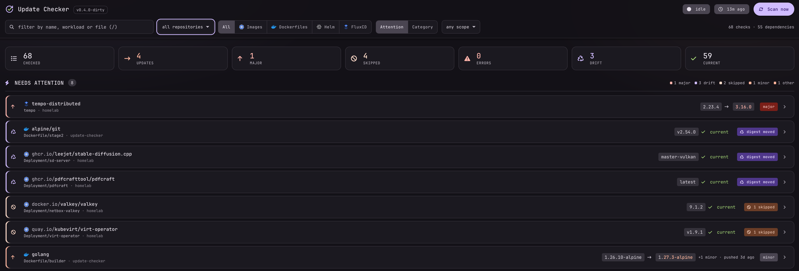
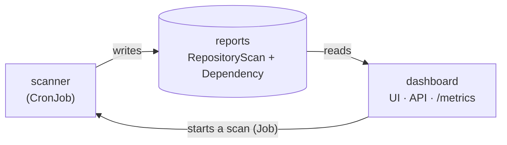
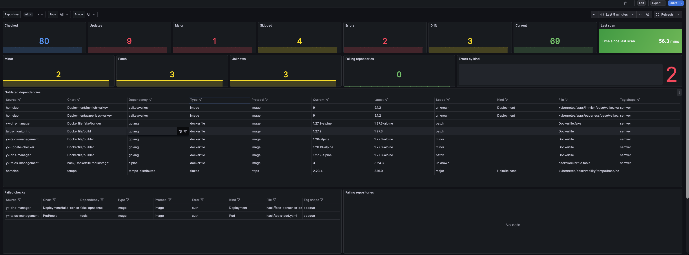

# yk-update-checker

Finds outdated dependencies in your GitOps repositories: Helm chart dependencies, FluxCD
`HelmRelease` charts, container images in Kubernetes manifests and `FROM` lines in Dockerfiles.
Results show up in a web UI, as Prometheus metrics and alerts, and as Kubernetes resources.



## How it works



- The **scanner** runs on a schedule: it clones each repository, checks every reference against its
  registry and writes one `RepositoryScan` per repository and one `Dependency` per reference.
- The **dashboard** shows those reports and can start a scan. It never clones anything and holds
  no credentials.

## Install

```bash
helm install yk-update-checker oci://ghcr.io/yuriy-kovalchuk/charts/yk-update-checker \
  --version <version> --namespace yk-update-checker --create-namespace -f values.yaml
```

Minimal `values.yaml`:

```yaml
scanner:
  config:
    repos:
      - name: homelab
        repo: https://github.com/example/my-gitops-repo
        path: kubernetes/apps   # optional
```

Open the UI through an Ingress (`ingress.enabled`) or `kubectl port-forward svc/yk-update-checker 8080:80`.
The reports are also plain Kubernetes objects:

```bash
kubectl get updatechecker                                                   # both kinds
kubectl get dependencies -l updatechecker.yuriykovalchuk.dev/outdated=true  # only what is behind
```

Install one release per namespace. The CRDs are cluster-wide, so with several releases in one
cluster set `crds.install: true` on only one of them.

> **No built-in authentication.** Anyone who can reach the Service can read the results and start
> scans. Protect it with a NetworkPolicy or an authenticated Ingress; see
> [Trust model & exposure](docs/architecture.md#trust-model--exposure).

## Configuration

```yaml
scanner:
  schedule: "0 0 * * *"      # when the CronJob scans
  history:
    runs: 10                 # past scans kept per repository
  config:
    update_type: all         # all | minor | patch
    scan_timeout: 30m
    check_images: true       # images in Kubernetes manifests
    check_dockerfiles: true  # FROM lines in Dockerfiles
    repos: []
```

Every value is documented in [`values.yaml`](charts/yk-update-checker/values.yaml). A config key
the binary does not know is logged as a warning; a wrong `update_type` or `auth.type` stops the scan.

### Private repositories

Create the Secret yourself and reference it; the chart never holds a token.

```bash
kubectl create secret generic homelab-github-token --from-literal=token=ghp_xxx
```

```yaml
scanner:
  config:
    repos:
      - name: homelab
        repo: https://github.com/example/homelab.git
        auth:
          type: token                     # token | basic | ssh
          existingSecret: homelab-github-token
```

- Only the scanner mounts the Secret, as a read-only file.
- `token` and `basic` require an `https://` URL.
- `ssh` repos also need `scanner.ssh.knownHosts` (the output of `ssh-keyscan`).
- Private image registries use `scanner.registryAuth.existingSecret`.

Full examples: [`examples/credentials.values.yaml`](examples/credentials.values.yaml) and
[`examples/private-repo-secrets.yaml`](examples/private-repo-secrets.yaml). Details:
[Authentication](docs/architecture.md#authentication).

### Monitoring

Set `metrics.serviceMonitor.enabled` and `metrics.prometheusRule.enabled` for Prometheus scraping
and alerts, and `grafana.dashboard.enabled` for the Grafana dashboard. The metrics and alerts are
listed in [Monitoring & alerting](docs/architecture.md#monitoring--alerting).



## Development

```bash
make run       # local dashboard on :8080, reports in ./data, scans as child processes
make test      # tests with the race detector
make kind      # local kind cluster with the locally built image and chart
make generate  # regenerate the CRDs after changing the report types
```

[docs/local-testing.md](docs/local-testing.md) covers local runs, [docs/architecture.md](docs/architecture.md)
the internals, and [AGENTS.md](AGENTS.md#known-issues) the known issues.

### Releasing

1. Set `version` and `appVersion` in `charts/yk-update-checker/Chart.yaml` to the new version.
2. Rename the `[Unreleased]` section of `CHANGELOG.md` to the new version and date.
3. Push the tag `vX.Y.Z`. CI publishes the image and chart to GHCR, and refuses a tag that does not
   match `Chart.yaml`.

## License

MIT
