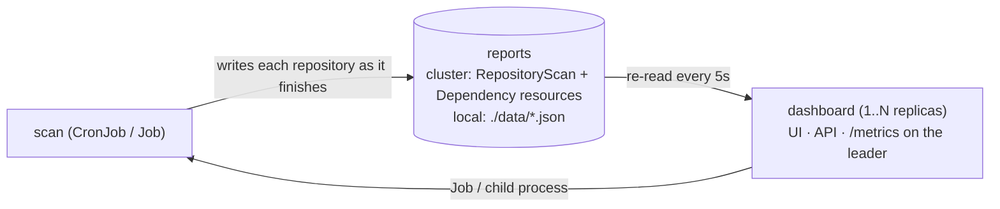

# yk-update-checker

Scans one or more GitOps repositories for outdated Helm chart dependencies, FluxCD HelmRelease resources and container images (workload pod specs plus `FROM` lines in Dockerfiles), then surfaces results in a web UI.

## Installation

```bash
helm install yk-update-checker \
  oci://ghcr.io/yuriy-kovalchuk/charts/yk-update-checker \
  --version <version> \
  -f values.yaml
```

One release per namespace: the reports (`kubectl get repositoryscans,dependencies`) are named after the
repository, so two releases in one namespace would overwrite each other. Every report carries the
`app.kubernetes.io/instance` label of the release that wrote it.

> **Exposure.** The dashboard, API and `/metrics` have no built-in authentication,
> and the chart ships no `NetworkPolicy`: anyone who can reach the Service can read
> results and start scans. (Writing the reports is not part of that surface — it
> needs Kubernetes API access, which RBAC controls.) Bound it with a
> NetworkPolicy and/or an authenticated ingress — see
> [Trust model & exposure](docs/architecture.md#trust-model--exposure).

## Quickstart

Minimum `values.yaml` — add at least one repo:

```yaml
scanner:
  config:
    repos:
      - name: homelab
        repo: https://github.com/example/my-gitops-repo
        path: kubernetes/apps   # optional sub-path
```

The chart deploys two workloads that never talk to each other:

| Workload | Kind | Role |
|---|---|---|
| `update-checker` | Deployment | Serves the UI + API on port 8080, starts manual scans, exports `/metrics` |
| `update-checker-scanner` | CronJob | One-shot scan pod: clones repos, checks versions, writes the reports |



The reports are Kubernetes objects in your namespace, so they survive a restart and
kubectl reads them without the UI:

```bash
kubectl get repositoryscans                       # or: kubectl get repscan
kubectl get dependencies -l updatechecker.yuriykovalchuk.dev/outdated=true
```

The UI is available at the configured Ingress host or via `kubectl port-forward`.

## Configuration

### Repos

```yaml
scanner:
  config:
    update_type: all        # all | minor | patch  ("major" is accepted and behaves as all)
    scan_timeout: 30m       # whole-scan budget; "0" = unbounded
    parallel_checks: 5
    check_images: true      # container images in Kubernetes workloads
    check_dockerfiles: true # base images in Dockerfile/Containerfile FROM lines
    verify_image_tags: true # reject stray candidate tags (backports, rebuilds, arch leftovers)

    repos:
      - name: my-gitops
        repo: https://github.com/example/my-gitops-repo
        path: kubernetes/apps
```

### Private repositories

Create a Secret yourself, then reference it from that repo's `auth` block. The
chart never creates or updates Secrets, and there is no place to put a token in
`values.yaml` — only a reference.

```bash
kubectl create secret generic homelab-github-token \
  --from-literal=token=ghp_xxxxxxxxxxxxxxxxxxxx

kubectl create secret generic gitea-basic-auth \
  --from-literal=password='hunter2'
```

```yaml
scanner:
  config:
    repos:
      - name: homelab
        repo: https://github.com/example/homelab.git
        auth:
          type: token
          existingSecret: homelab-github-token

      - name: gitea-apps
        repo: https://gitea.example.com/infra/apps.git
        auth:
          type: basic
          username: ci-readonly        # a username is not a secret
          existingSecret: gitea-basic-auth
```

What the chart does with that reference:

| | |
|---|---|
| Mounts | the referenced key, read-only, mode `0440`, one file per repo, in the **scan pod only** (the CronJob and the Jobs started from it): the dashboard never clones, so it holds no credentials and a missing Secret cannot stop it. Secret volume files are owned by root and `fsGroup` only sets the group, so `fsGroup` must stay set in `scanner.podSecurityContext` — the chart fails the render if a credential is declared without it |
| Path | `/etc/update-checker-scanner/secrets/<repo name>/<key>` |
| Writes into the ConfigMap | `auth.token_file` / `auth.password_file` / `auth.ssh_key_path` pointing at that file. `existingSecret` itself never reaches the pod — the scanner knows nothing about Kubernetes |
| Key defaults | `token` → `token`, `basic` → `password`, `ssh` → `id_ed25519`; override with `existingSecretKey` (e.g. `ssh-privatekey` for a Secret made with `--from-file=ssh-privatekey`) |
| Rotating a credential | edit the Secret; the next scan picks it up, no redeploy |
| SSH host keys | an `ssh` repo must say which host keys to trust: put `ssh-keyscan -t ed25519,rsa github.com` output in `scanner.ssh.knownHosts` and the chart mounts it and sets `auth.known_hosts_file` for you. Without it the render fails, because a short-lived pod on a read-only rootfs otherwise accepts **any** host key it is shown (a man in the middle can then feed your scan a forged repository). `scanner.ssh.strictHostKeyChecking: false` is the explicit opt-out |
| Mistakes | rendered fail-first, naming the repo: `existingSecret` without `auth.type`, an unknown type, `existingSecret` next to an explicit `token_file`, a credential value inline in the config, credentials embedded in the repo URL, `token`/`basic` over a non-https URL, an ssh repo with no host keys, or two repo names that sanitize to one mount directory |

Supported auth types: `token`, `basic`, `ssh` — `token` and `basic` send an
`Authorization` header, so they require an `https://` repo URL (over `http://` that
header is plaintext, and the chart refuses to render it). Complete overlay:
[`examples/credentials.values.yaml`](examples/credentials.values.yaml);
Secret manifests: [`examples/private-repo-secrets.yaml`](examples/private-repo-secrets.yaml).
Running the binary directly (no Helm) reads `token_file` / `password_file` /
`ssh_key_path` — see [`examples/config.example.yaml`](examples/config.example.yaml).

### Key values

```yaml
scanner:
  schedule: "0 0 * * *"     # CronJob schedule (default: daily at 00:00)
  suspend: false             # suspend the CronJob without deleting it
  history:
    runs: 10                 # scan runs kept in each RepositoryScan's status.history
  ssh:
    strictHostKeyChecking: true   # ssh repos need scanner.ssh.knownHosts
    knownHosts: ""                # ssh-keyscan -t ed25519,rsa github.com

replicaCount: 1              # the reports are cluster state, so more than one is fine;
                             # only the leader exports the result metrics

ingress:
  enabled: false
  hosts:
    - host: update-checker.example.com
      paths:
        - path: /
          pathType: Prefix

rbac:
  create: true               # two Roles: the dashboard's (scan Jobs, report reads,
                             # leader Lease) and the scanner's (report writes only)
```

Full reference: [`charts/yk-update-checker/values.yaml`](charts/yk-update-checker/values.yaml).

Config validation is deliberately asymmetric: a key this build does not read is logged
as a startup warning with its exact path (`repos[0].auth.existingSecret`, `git_cache_dirr`,
…) and the scan still runs, so a config written for a newer image never breaks a CronJob.
A value that would silently change what is reported, or which credentials are sent, is a
hard error naming the key: `update_type` must be `all`, `major`, `minor` or `patch`
(case-insensitive), `auth.type` must be `token`, `basic` or `ssh`, credentials may
not be embedded in a repo URL, `token`/`basic` require `https://`, and credentials
may not be configured without an `auth.type` (they would be read and then silently
unused). Run
`update-checker scan --config your.yaml` to see both before deploying.

## Development

```bash
make build      # compile → bin/update-checker
make run        # build + run the local dashboard (reports in ./data, scans as child processes)
make kind       # kind cluster + locally built image + chart, for testing the deployment
make test       # run tests with race detector
```

Executed locally, the reports are **files, not memory**: `./data/` (gitignored), one JSON file per
report object — `data/repositoryscans/<repo>-<hash>.json` and
`data/dependencies/<repo>-<type>-<hash>.json`, the same two kinds the cluster keeps as custom
resources. `--data=<dir>` moves the tree, `rm -rf data` empties the dashboard, and the dashboard
re-reads the directory every 5 seconds, so a scan written by a child process shows up without a
restart.

See [docs/local-testing.md](docs/local-testing.md) for a full local setup guide and [docs/architecture.md](docs/architecture.md) for internals. Known issues are listed in [AGENTS.md](AGENTS.md#known-issues).

Releases are triggered by pushing a `v*` tag — CI builds the Docker image and Helm chart and
publishes both to GHCR.

### Releasing

CI packages the chart exactly as `charts/yk-update-checker/Chart.yaml` declares it, so a release
starts with a **release-prep commit**:

1. Bump `version` and `appVersion` in `Chart.yaml` to the new release (both track the tag without
   the `v`; `deployment.yaml` falls back to `appVersion` for the image tag, and `version` is the
   chart's own semver — it may move on its own for a chart-only fix).
2. Turn `CHANGELOG.md`'s `[Unreleased]` section into a dated `[X.Y.Z]` section and add its
   `compare/vPREVIOUS...vX.Y.Z` link ref.
3. Tag `vX.Y.Z` and push. If `Chart.yaml` does not match the tag, CI fails the release instead of
   publishing a chart whose default image tag was never built.

## License

MIT
